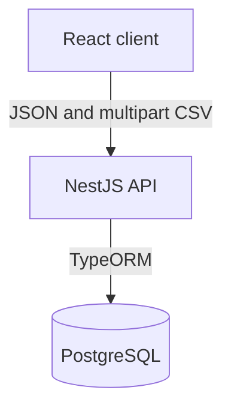
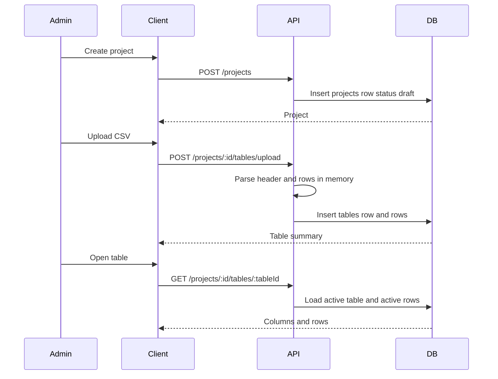
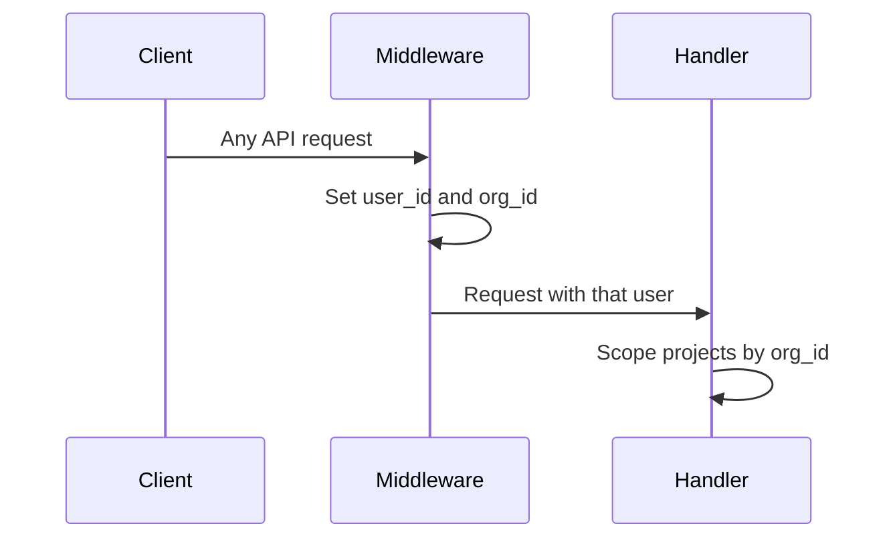

# Architecture

> **Agent instructions:** [instructions.md](/.onesquad/instructions.md)
> **Status:** Approved
> **Approved by:** Aviral Agrawal <Avi.aviral2001@gmail.com> — 2026-10-10T11:49:36Z
> **Source:** Reverse-engineered from the codebase. Product constraints are in [overview.md](overview.md).

## Summary

Forma is a pnpm monorepo with three packages: a React client, a NestJS API, and a shared TypeScript package. The API stores projects, tables, and rows in PostgreSQL. CSV uploads are parsed in the API process and written as rows. They are not stored as files.

Deployment is intentionally not decided. No cloud provider, region, or compute model is selected until the product is ready to ship.

## Tech stack

| Concern | Decision | Why | Rejected |
| --- | --- | --- | --- |
| Frontend | React 18, TypeScript, React Router 6, Create React App (`react-scripts` 5) | Already the client. Routing is a short list of project screens. | A second frontend framework. |
| Tables UI | AG Grid Community 29 (`ag-grid-react`), Alpine theme | The tables screen is a read-only grid with sort, filter, and paging. | A hand-built table. |
| Styling | CSS custom properties in `apps/frontend/src/styles/` | Tokens and components already exist. No utility-CSS compiler is in the app. | Introducing Tailwind for the current screens. |
| Backend | NestJS 9 on Express, TypeScript | Already the API. Modules match the two built features: `projects` and `tables`. | A second HTTP framework. |
| Validation | `class-validator` via a global `ValidationPipe` | Create and rename bodies already use DTO decorators. | Ad-hoc checks only. |
| Database | PostgreSQL, accessed through TypeORM 0.3 | Projects, tables, and rows are relational. Column definitions and cell values are JSON. | A document database for the whole model. |
| Shared types | `packages/shared`, consumed as `@forma/shared` | Client and API share project and table shapes. | Duplicating types in each app. |
| CSV ingest | In-memory multipart upload (`FileInterceptor`, field `file`). Parse in `TablesService`. | The product stores rows, not the original file. | Object storage for the current feature. |
| Authentication | Not implemented. `DevAuthMiddleware` sets one `user_id` and one `org_id` on every request. | Sign-in is out of the built product. The API still scopes projects by `org_id`. | Pretending a real identity provider exists. |
| AI | None | The built product does not call a model. | Adding an AI dependency. |
| Secret management | Environment variables (`DB_HOST`, `DB_PORT`, `DB_USERNAME`, `DB_PASSWORD`, `DB_NAME`, `BACKEND_PORT`) | That is what `AppModule` and `main.ts` read. | A secrets manager before deployment exists. |

## Infrastructure

Not selected. The repository has no cloud account, region, container image, CI workflow, or infrastructure-as-code.

| Topic | Decision |
| --- | --- |
| Cloud provider | None. Decide at deploy time. |
| Region | None. |
| Compute model | None. Serverless, containers, and VMs are all still open. |
| Networking | The client calls the API directly. CORS allows the frontend origin configured in `main.ts`. |
| CI/CD | None. |
| Environments | One. Configuration comes from environment variables. Separate staging and production are not defined. |
| Database hosting | PostgreSQL. Connection settings come from the environment. |
| File storage | None. CSV bytes live only for the request that parses them. |
| Email, queue, search, cache, CDN, monitoring | None. |

## Components

| Component | Responsibility |
| --- | --- |
| `apps/frontend` | Project list, project workspace, tables grid, API client modules `api/projects.ts` and `api/tables.ts`. |
| `apps/backend` | HTTP API. `ProjectsModule` and `TablesModule`. Global validation. Auth stand-in middleware on every route. |
| `packages/shared` | Shared TypeScript types. |
| PostgreSQL | `projects`, `tables`, `rows`. Migrations in `apps/backend/src/migrations/`. `migrationsRun` is true. |

Empty directories `master-table`, `users`, `formula`, and `workflow` are not components. They have no code.

## Communication

The client uses `fetch`. Project and table calls send no credentials. The middleware attaches the principal before the controller runs.

## Data flow

Cell values are a JSON object on each row, keyed by `column_id`. Re-upload marks existing rows deleted and inserts new ones. Delete marks the table and its rows deleted. Project delete removes the project row. The migration cascades table deletes from the project.

## Authentication flow

There is no login, session, or token. Table handlers do not check `org_id` or that `:tableId` belongs to `:projectId`. That trust boundary is a gap, recorded below. It is not a second auth system.

## External integrations

| System | Use |
| --- | --- |
| None | The built product does not call a third-party API. |

AG Grid and the fonts named in CSS are frontend libraries and font stacks, not runtime integrations.

## Decisions

### ADR-001 — Keep the current three-package shape

**Status:** Accepted, already in the repo.

The client, API, and shared types stay separate workspaces. Feature code for projects and tables stays inside the matching Nest module and the matching React pages. New product areas get a new module when they are built, not a folder of unused files.

### ADR-002 — PostgreSQL is the system of record

**Status:** Accepted, already in the repo.

Projects are rows. A table's columns are JSON on the table. A row's cells are JSON on the row, keyed by column id. The API does not keep a second store for CSV contents.

### ADR-003 — Do not choose deployment yet

**Status:** Accepted as a deferral.

The operator will deploy after the product work is further along. This spec does not pick a provider, region, or compute model. When deployment starts, `@os-architect` supersedes this ADR with a new one. Until then, `@os-devops` has nothing to provision.

### ADR-004 — Authentication stays a single stand-in principal

**Status:** Accepted for the current build only.

Every request is one user in one organisation. Projects are filtered by that `org_id`. Replacing this is a future feature with its own spec. Do not add a provider inside unrelated work.

## Security notes

- The API has no authenticated caller. Anyone who can reach it acts as the stand-in organisation.
- Table reads and writes trust the id in the path. They do not prove the table is in that project or organisation.
- Database credentials are environment variables. They must not be committed.
- CSV contents are written into JSON cells with no separate malware or size policy. The product spec leaves max file size open.

## Open decisions

None that block the current build. Deployment remains deferred under ADR-003. Schema drift between migrations and entities is a code defect recorded in [overview.md](overview.md), not a new platform choice.
