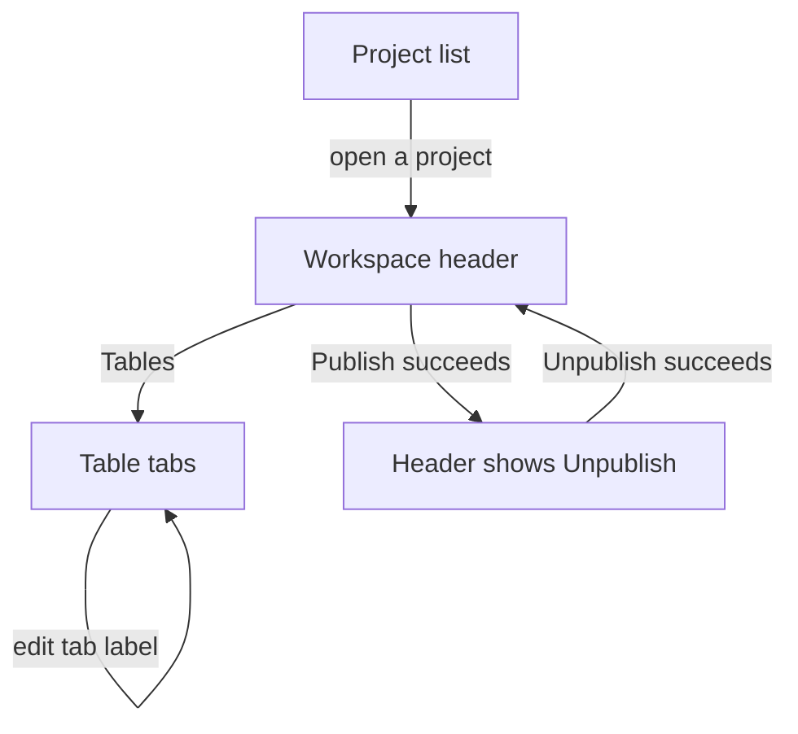

# Finish phases 1 and 2 — UX Spec

> **Agent instructions:** [instructions.md](/.onesquad/instructions.md)
> **Issue:** [NQ-PLAN](https://app.notion.com/p/36a052c5da78814796c1cd0010999494)
> **Feature spec:** [spec.md](spec.md)
> **Status:** Approved
> **Approved by:** Aviral Agrawal <Avi.aviral2001@gmail.com> — 2026-10-10T17:00:33Z

## Screens

The project list, the workspace header, and the table tabs already exist. This spec changes the header action and the tab label. It adds no new page.

## Navigation Flow

## Screen: Workspace header

Existing header: back control "← Projects", the project name, the status badge, then the action on the right. Breadcrumb and sidebar stay as they are.

### Layout

One row. Left group is back, title, badge. Right group is the single action. The action is absent when status is `closed`.

### Components

| Component | Type | Label | State | Behaviour |
| --- | --- | --- | --- | --- |
| Back | Button, ghost | ← Projects | default | Opens `/projects` |
| Title | Heading, or the existing title input | Project name | display, editing | Unchanged from the projects spec |
| Badge | `status-badge` | Draft, Published, or Closed | static | Capitalised status word. Closed uses `status-closed` |
| Publish | `btn-secondary` | Publish | disabled | Shown on draft when any publish condition is unmet. Hover or focus shows the tooltip |
| Publish | `btn-primary` | Publish | default | Shown on draft when all five conditions are met. Click calls publish |
| Publish | `btn-primary` | Publishing... | disabled | Shown while the publish request is in flight |
| Unpublish | `btn-destructive` | Unpublish | default | Shown when status is `published`. Click calls unpublish |
| Unpublish | `btn-destructive` | Unpublishing... | disabled | Shown while the unpublish request is in flight |
| Tooltip | Tooltip | One line per unmet condition | visible on hover or focus | Lines are only the unmet items, in this order: "At least one table", "At least one column", "At least one user", "Valid formulas", "Valid routing config" |

### States

- **Empty:** The header is not shown without a project. The existing not-found state stays.
- **Loading:** The existing "Loading..." line. No Publish control until the project has loaded.
- **Error:** If publish or unpublish fails for a reason other than unmet conditions, the existing `error-banner` shows one sentence. The badge stays on the previous status.
- **Success:** Publish sets the badge to Published and swaps the action to Unpublish. Unpublish sets the badge to Draft and swaps the action back to Publish, enabled or disabled from the five conditions.
- **Disabled:** Publish is disabled while any condition is unmet, and while a request is in flight.

### Interactions

Clicking enabled Publish sends the publish request. Clicking Unpublish sends the unpublish request. There is no confirm dialog. There is no Close control.

### Validation

The tooltip and the disabled Publish button are the validation. The five lines above are the only copy.

## Screen: Table tabs

Existing tab strip inside Tables. One tab per table, a menu, and "+".

### Layout

Unchanged strip. The tab label becomes an input while that tab is being renamed. The menu no longer contains Rename.

### Components

| Component | Type | Label | State | Behaviour |
| --- | --- | --- | --- | --- |
| Tab label | Button, then the workspace title input | Table name | display, editing | Click selects the tab. A second click on the active tab's label, or Enter while the tab is focused, opens the input |
| Tab input | Input, text | Current name | editing | Enter or blur saves. Escape restores the previous name and closes the input. A blank trimmed name does not save |
| Menu | Existing tab menu | ⋮ | open, closed | Items are Reupload and Delete |
| Delete error | `error-banner` | Cannot delete table that is referenced in master table | visible | Shown when delete is rejected. The tab stays |

### States

- **Empty:** Existing "No tables yet" empty state. No tab to rename.
- **Loading:** Existing "Loading tables...".
- **Error:** Existing banner for a failed rename: "Failed to rename table". The tab label returns to the stored name.
- **Success:** The tab shows the new name without a modal.
- **Disabled:** The input is not disabled. Save is refused only for a blank name.

### Interactions

Rename no longer opens `RenameTableModal`. Column rename still opens `RenameColumnModal` from the header pencil. Reupload and Delete stay on the menu and keep their modals.

### Validation

Blank name: input closes and the previous name remains, with no request. Server rejection: error banner, previous name remains.

## Screen: Project list card

### Layout

Unchanged card.

### Components

| Component | Type | Label | State | Behaviour |
| --- | --- | --- | --- | --- |
| Badge | `status-badge` | Draft, Published, or Closed | static | A closed project stays on this admin list |

### States

- **Empty:** Existing empty state.
- **Loading:** Existing "Loading projects...".
- **Error:** Existing "Failed to load projects".
- **Success:** The card badge matches `projects.status`, including Closed.

### Interactions

Opening a closed project shows the workspace with the Closed badge and no Publish or Unpublish action.

### Validation

None on the card.

## Design System References

- Button variants `btn-secondary`, `btn-primary`, `btn-destructive`, and the disabled state
- Badge `status-draft`, `status-published`, `status-closed`
- Tooltip
- Title input pattern already used by the workspace name
- `error-banner`
- Table tabs pattern, with Rename removed from the menu
